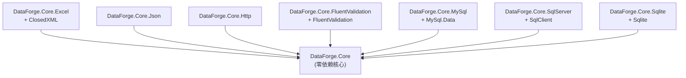

# DataForge.Core 架构设计文档

> 版本：0.1.0 | 目标框架：net8.0 | 最后更新：2026-06-11

---

## 1. 系统概述

DataForge.Core 是一个轻量级 .NET 数据处理库，提供统一的数据源访问、流式转换、验证和导出能力。设计哲学围绕 **"声明式数据管道"** 模式，让数据 ETL 流程像编写 LINQ 查询一样简洁。

### 核心设计原则

| 原则 | 说明 |
|------|------|
| **管道模式** | 一切数据操作以 `IDataPipeline<T>` 为上下文，链式构建 Source → Transform → Validate → Target |
| **零依赖核心** | 核心包 `DataForge.Core` 无任何外部依赖，仅依赖 `net8.0` 基础运行时 |
| **插件扩展** | Excel/Json/Http/数据库等通过独立 NuGet 包扩展，按需引入 |
| **流式处理** | 基于 `IAsyncEnumerable<T>` 的内部实现，避免全量加载到内存 |
| **类型安全** | 从数据源到目标的全链路泛型约束，编译期类型检查 |

---

## 2. 包结构与依赖关系

### 2.1 8 个 NuGet 包清单

| 包 ID | 说明 | 外部依赖 |
|-------|------|---------|
| `DataForge.Core` | 核心库：管道引擎、数据源抽象、CSV/Memory 源与目标 | **无** |
| `DataForge.Core.Excel` | Excel 读写支持（基于 ClosedXML） | `ClosedXML 0.102.1` |
| `DataForge.Core.Json` | JSON 读写支持 | 无 |
| `DataForge.Core.Http` | REST API 数据源与目标 | 无 |
| `DataForge.Core.FluentValidation` | FluentValidation 集成 | `FluentValidation` |
| `DataForge.Core.MySql` | MySQL 数据源与目标 | `MySql.Data` |
| `DataForge.Core.SqlServer` | SQL Server 数据源与目标 | `Microsoft.Data.SqlClient` |
| `DataForge.Core.Sqlite` | SQLite 数据源与目标 | `Microsoft.Data.Sqlite` |

### 2.2 包依赖图



所有 7 个扩展包都**仅依赖** `DataForge.Core`，包之间相互独立，用户可按需组合。

---

## 3. 核心架构：管道模式

### 3.1 数据流图

```mermaid
flowchart LR
    subgraph Sources["数据源 (Source)"]
        CSV["CSV 文件"]
        MEM["内存集合"]
        JSON["JSON 文件"]
        EXCEL["Excel 文件"]
        HTTP["REST API"]
        DB["数据库"]
    end

    ENTRY["DataForgePipeline\n(工厂入口)"]

    subgraph Pipeline["数据处理管道"]
        direction TB
        P1["链式变换操作\nWhere / Select / OrderBy\nGroupBy / Zip / Take ..."]
        P2["验证层\nValidateWith / IValidator"]
        P3["性能增强\nWithProgress / WithCounter\nWithParallelization"]
    end

    subgraph Targets["数据目标 (Target)"]
        T_CSV["CSV 输出"]
        T_JSON["JSON 输出"]
        T_EXCEL["Excel 输出"]
        T_CONSOLE["Console 输出"]
        T_API["REST API"]
        T_DB["数据库"]
        T_MEM["内存集合"]
    end

    Sources --> ENTRY
    ENTRY --> Pipeline
    Pipeline --> Targets
```



### 3.2 管道生命周期

```
DataForgePipeline.FromXxx<T>()     → IDataPipeline<T>  (惰性构建，不执行)
    .Where(...)                    → IDataPipeline<T>  (追加操作)
    .Select(...)                   → IDataPipeline<T>
    .ValidateWith(...)             → IDataPipeline<T>
    .ToCsvAsync(...)               → Task<ExportResults> (触发执行)
```

管道在调用终端方法（`ToXxxAsync` / `ToListAsync` 等）时才真正执行数据流动。所有中间操作都是延迟的。

---

## 4. 分层设计

### 4.1 入口层

| 类 | 命名空间 | 说明 |
|----|---------|------|
| `DataForgePipeline` | `DataForge.Core` | 静态门面，提供 `FromCsv`/`FromMemory`/`FromJson`/`FromExcel`/`FromJsonString`/`Merge` 等工厂方法 |

### 4.2 管道层

| 接口 | 命名空间 | 说明 |
|------|---------|------|
| `IDataPipeline<T>` | `DataForge.Core.Core.Pipeline` | 核心管道接口，定义全部链式操作和终端方法 |
| `IGroupedDataPipeline<TKey,T>` | `DataForge.Core.Core.Pipeline` | 分组管道接口，提供 `Select`/`OrderBy`/`ToDictionary` |
| `DataPipeline<T>` | `DataForge.Core.Core.Pipeline` | 管道主实现类（`IAsyncEnumerable` 驱动） |

### 4.3 数据源层

| 接口 | 说明 |
|------|------|
| `IDataSource<T>` | 基础数据源契约：`ReadAsync()` / `ReadAllAsync()` / `GetMetadataAsync()` |
| `IFileDataSource<T>` | 文件数据源扩展：`FilePath` / `ExistsAsync()` |
| `IRelationalDataSource<T>` | 关系型数据源扩展：`QueryAsync(sql, params)` |

### 4.4 数据目标层

| 接口 | 说明 |
|------|------|
| `IDataTarget<T>` | 数据目标契约：`ExportAsync()` / `WriteAsync()` / `WriteBatchAsync()` / `CompleteAsync()` |

### 4.5 验证层

| 类/接口 | 说明 |
|---------|------|
| `IValidator<T>` | 验证器接口：`Validate()` / `ValidateAsync()` |
| `DataValidator<T>` | 验证器抽象基类，提供 `RuleFor()` 方法构建验证规则 |
| `ValidationRuleBuilder<T,TProperty>` | 链式规则构建器：`Required()` / `NotEmpty()` / `InRange()` / `Must()` / `When()` 等 |
| `ValidationResult` / `ValidationError` | 验证结果模型 |
| `ValidationException` | 验证异常 |

### 4.6 转换层

| 类/接口 | 说明 |
|---------|------|
| `IDataTransform<TSource,TResult>` | 同步转换器接口 |
| `IAsyncDataTransform<TSource,TResult>` | 异步转换器接口 |
| `MapTransform` / `CastTransform` / `DateFormatTransform` / `TrimTransform` / `LookupTransform` / `ComposeTransform` 等 | 12 个预置转换器 |

---

## 5. 扩展机制

### 5.1 扩展管道方法

扩展包通过 `IDataPipeline<T>` 上的扩展方法向管道注入 `FromXxx` / `ToXxx` 能力：

```csharp
// 例如：DataForge.Core.Json 提供的扩展
public static IDataPipeline<T> FromJson<T>(this DataForgePipeline builder, string filePath, ...);
public static Task<ExportResults> ToJson<T>(this IDataPipeline<T> pipeline, string filePath, ...);
```

### 5.2 内置扩展方法（核心包）

`DataForgePipeline` 自身提供以下内置工厂方法：

| 方法 | 说明 |
|------|------|
| `FromCsv<T>(filePath, options?)` | 从 CSV 文件创建管道 |
| `FromJson<T>(filePath, options?)` | 从 JSON 文件创建管道 |
| `FromExcel<T>(filePath, sheetName?)` | 从 Excel 文件创建管道 |
| `FromMemory<T>(IEnumerable<T>)` | 从内存集合创建管道 |
| `FromJsonString<T>(jsonContent)` | 从 JSON 字符串创建管道 |
| `FromJsonArray<T>(filePath)` | 等价于 `FromJson<T>` |
| `Merge<T>(params IDataSource[])` | 合并多个数据源 |

### 5.3 扩展包提供的扩展方法

| 扩展包 | 命名空间 | 提供的方法 |
|--------|---------|-----------|
| `DataForge.Core.Excel` | `DataForge.Core.Excel` | `FromExcel<T>()` / `ToExcel<T>()` |
| `DataForge.Core.Json` | `DataForge.Core.Json` | `FromJson<T>()` / `ToJson<T>()` |
| `DataForge.Core.Http` | `DataForge.Core.Http` | `FromRestApi<T>()` / `FromRestApiWithPagination<T>()` / `ToRestApi<T>()` |

### 5.4 自定义数据源

实现 `IDataSource<T>` 接口即可接入任意数据源：

```csharp
public class MyCustomSource<T> : IDataSource<T>
{
    public string Name => "MySource";
    public DataSourceType SourceType => DataSourceType.Custom;

    public async IAsyncEnumerable<T> ReadAsync([EnumeratorCancellation] CancellationToken ct = default)
    {
        // 自定义数据读取逻辑
    }
}
```

### 5.5 面向接口编程

管道核心接口 `IDataPipeline<T>` 本身就是稳定的扩展点。管道装饰器模式使得为管道追加行为（如性能监控、日志记录、重试机制）变得简单：实现 `IDataPipeline<T>` 包装内部管道即可。

---

## 6. 错误处理与验证策略

### 6.1 管道错误处理

| 管道方法 | 行为 |
|---------|------|
| `OnErrorContinue()` | 遇到异常时跳过当前项继续 |
| `OnErrorStop()` | 遇到异常时停止管道 |
| `OnErrorSkip()` | 遇到异常时跳过 |
| `OnError(Func<Exception,T,ErrorAction>)` | 自定义异常处理策略 |

### 6.2 验证策略

| 管道方法 | 行为 |
|---------|------|
| `ValidateWith(IValidator<T>)` | 注册验证器（默认：验证失败抛异常） |
| `ContinueOnValidationError()` | 验证失败时过滤掉无效项继续 |
| `FailOnValidationError()` | 验证失败时抛 `ValidationException` |

### 6.3 性能工具

| 扩展方法 | 来源 | 说明 |
|---------|------|------|
| `WithProgress(Action<ProgressReport<T>>, int)` | `PerformanceExtensions` | 每 N 条报告进度 |
| `WithCounter(PerformanceCounter)` | `PerformanceExtensions` | 附加性能计数 |
| `WithParallelization(int)` | `PerformanceExtensions` | 并行处理（保序） |
| `WithParallelizationUnordered(int)` | `PerformanceExtensions` | 并行处理（不保序，更快） |

---

## 7. 版本与兼容性

| 属性 | 值 |
|------|-----|
| 目标框架 | `net8.0` |
| 语言版本 | C# 12 |
| 可空引用类型 | 启用 (`Nullable: enable`) |
| 隐式 Using | 启用 |
| 生成 NuGet 包 | 是 (`GeneratePackageOnBuild: true`) |
| 仓库地址 | https://github.com/kongliuli/DataForge.Core |
